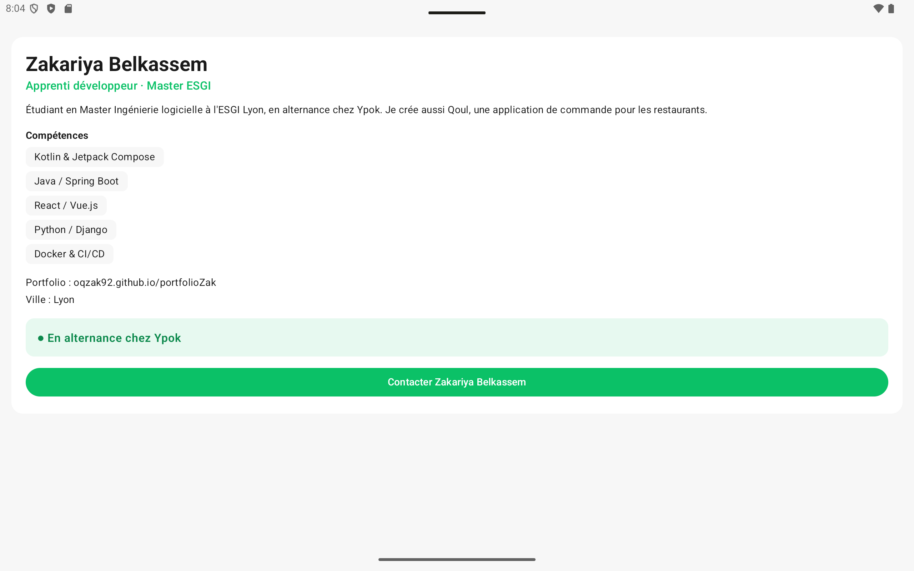

# Profil développeur Compose

Application Android (Kotlin + Jetpack Compose) qui affiche une fiche « Profil développeur ».

## Description

L'écran affiche la fiche d'un développeur : son **nom**, son **rôle**, une **courte description**,
une **liste de compétences**, ses **informations de contact** (portfolio, ville) et sa **disponibilité**.
La disponibilité est une zone cliquable personnalisée et accessible, et un bouton « Contacter » permet
de déclencher une action. Toutes les données sont passées en paramètres : le même code affiche
plusieurs profils différents (voir les deux previews).

## Notions utilisées

- fonctions composables (`@Composable`) et arbre de composition ;
- paramètres (nom, rôle, description, compétences, disponibilité, texte du bouton…) ;
- `Modifier` passé en paramètre (`modifier: Modifier = Modifier`) ;
- chaînage de modifiers (`fillMaxWidth().clickable(...).semantics { ... }`) ;
- padding externe / padding interne ;
- callbacks (`onContactClick`, `onDisponibiliteClick`) ;
- `Scaffold` et `innerPadding` ;
- `Surface`, `Column`, `Text`, `Button` ;
- previews (`@Preview`) ;
- accessibilité de base (`Role.Button`, `onClickLabel`, `contentDescription`) ;
- thème personnalisé (`ui/theme`) aux couleurs de mon projet **Qoul** (vert `#0BC167`).

Aucune notion hors programme : pas de `remember`, `mutableStateOf`, `LazyColumn`, ViewModel, API…
La liste des compétences est affichée avec une simple boucle `for` dans une `Column`.

## Explication courte

**1. Quels composables avez-vous créés ?**
`EcranProfil`, `CarteProfil`, `EnTeteProfil`, `ListeCompetences`, `Competence`, `LigneInfo`,
`BadgeDisponibilite`, `BoutonContact`, plus deux previews : `PreviewProfilZakariya` et
`PreviewProfilFullStack`. Tout est dans `app/src/main/java/com/example/profildeveloppeur/MainActivity.kt`.

**2. Quel composable représente l'écran principal ?**
`EcranProfil`. Il est appelé dans `setContent`, à l'intérieur du `Scaffold`, qui lui passe
`Modifier.padding(innerPadding)`.

**3. Où utilisez-vous un padding externe ?**
Dans `EcranProfil` : c'est le parent qui place la fiche dans l'écran avec
`Modifier.fillMaxWidth().padding(16.dp)` passé à `CarteProfil`. Même principe dans `CarteProfil`, qui
espace ses enfants avec `Modifier.padding(top = ...)` (ex. `ListeCompetences`, `BadgeDisponibilite`).

**4. Où utilisez-vous un padding interne ?**
À l'intérieur des composants : `CarteProfil` met `padding(20.dp)` sur la `Column` dans sa `Surface`
(le contenu ne colle pas au bord de la fiche), `Competence` met un padding autour du texte
de sa pastille, et `BadgeDisponibilite` met `padding(16.dp)` autour de son texte.

> Différence : le padding **externe** est décidé par le parent (via le `modifier` reçu) et éloigne
> le composant de ce qui l'entoure ; le padding **interne** est décidé par le composant lui-même et
> éloigne son contenu de ses propres bords (le fond coloré de la `Surface` s'étend sous ce padding).

**5. Quel composant reçoit un callback ?**
`BoutonContact` reçoit `onClick` et `BadgeDisponibilite` reçoit `onClick`. Ils remontent depuis
`CarteProfil` et `EcranProfil` (`onContactClick`, `onDisponibiliteClick`) jusqu'à `MainActivity`, où
ils contiennent seulement un commentaire : le composant signale le clic, il ne décide pas de la logique.

**6. Quelle information d'accessibilité avez-vous ajoutée ?**
Sur la zone cliquable personnalisée `BadgeDisponibilite` :
- `clickable(role = Role.Button, ...)` : TalkBack annonce un « bouton » ;
- `onClickLabel = "voir les disponibilités"` : TalkBack décrit l'action ;
- `semantics { contentDescription = "Statut : ..." }` : une description claire de la zone.

`BoutonContact` utilise un `Button` Material : il est déjà plus explicite qu'une zone cliquable
personnalisée, car il a nativement le rôle « bouton » et son texte sert de description.

**7. Pourquoi vos composants peuvent-ils être considérés comme réutilisables ?**
Ils n'affichent aucune donnée « en dur » : tout arrive par des paramètres (textes, liste, booléen,
callbacks) et chacun accepte un `modifier: Modifier = Modifier` utilisé sur son élément racine, ce
qui laisse le parent décider de son placement. Preuve : les deux previews affichent deux profils
différents (moi, **en alternance** / Sarah, full-stack **non disponible**,
compétences différentes) avec exactement les mêmes composables, et `Competence` / `LigneInfo` sont réutilisés plusieurs fois.

## Lancer le projet

1. Ouvrir le dossier dans Android Studio.
2. Previews : ouvrir `MainActivity.kt` puis la vue **Split**.
3. Application : bouton **Run** ▶ sur un émulateur ou un téléphone.
